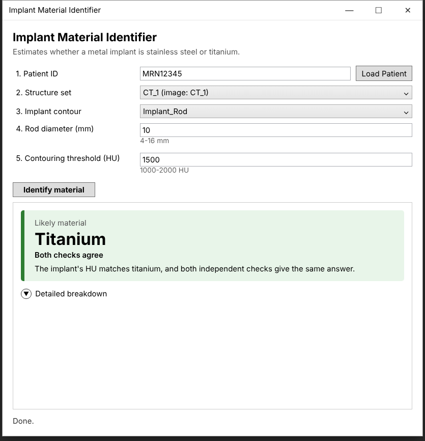
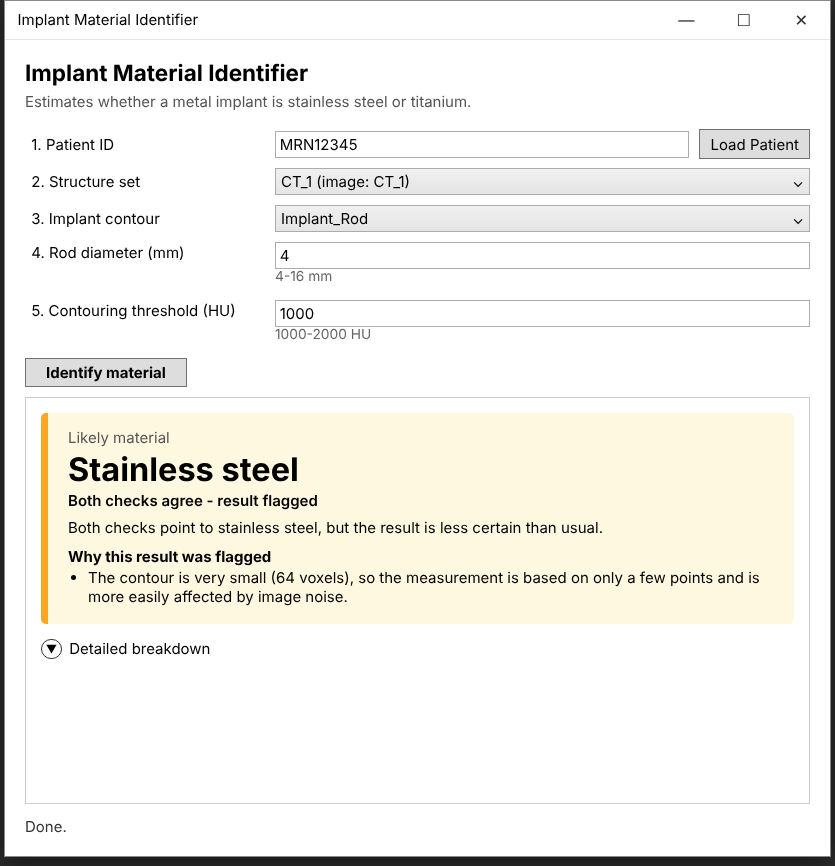
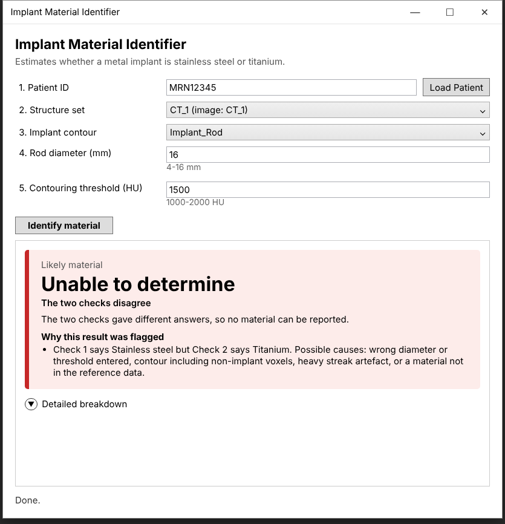
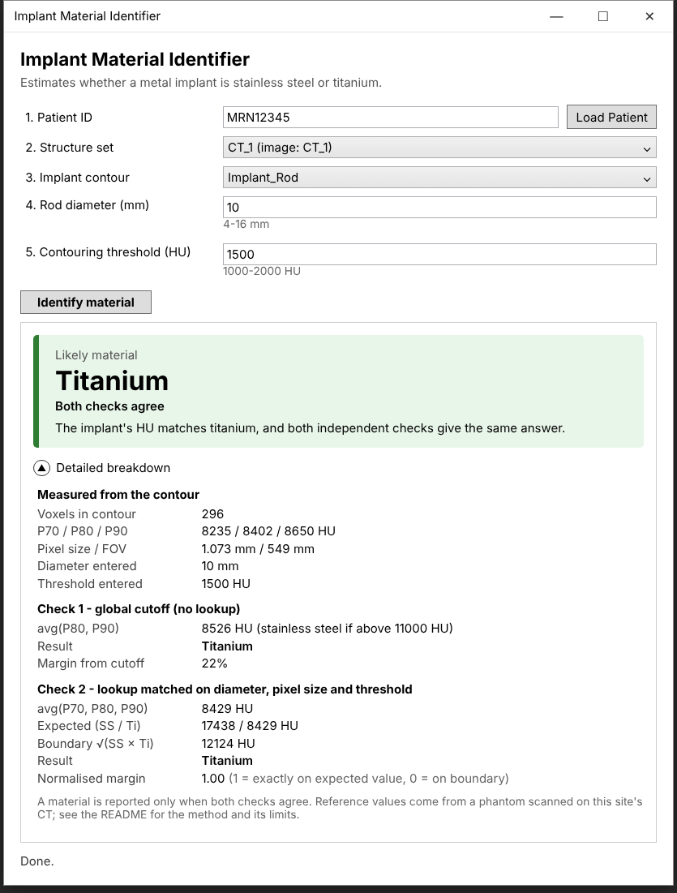

# Implant Material Identifier (standalone ESAPI executable)

A stand-alone ESAPI WPF application (MVVM) that:

1. Opens a patient by ID.
2. Lets you pick a structure set, then a structure (the contoured metal implant).
3. Computes the **P70, P80 and P90 HU** of that structure from every CT voxel it contains,
   plus the CT's **pixel size**.
4. Takes a user-entered **implant diameter (mm)** and the **HU threshold** that was used to
   create the structure.
5. Runs two classifiers - a global cutoff on avg(P80, P90), and a lookup of avg(P70, P80, P90)
   matched on diameter, pixel size and threshold - and reports stainless steel or titanium
   only when they agree, flagging anything that needs manual review. See
   ["Classification method"](#classification-method) below.

## What it looks like

The answer is shown as a colour-coded card: **green** when both checks agree, **amber** when
they agree but something was flagged (shown on the card), and **red** when they disagree and
no material is reported.

| Both checks agree | Result flagged | Checks disagree |
|---|---|---|
|  |  |  |

The numbers behind the result are in the collapsible **Detailed breakdown**:



These are renderings of the window layout, not screenshots taken on Windows, so fonts and
control styling differ slightly from the real app. The green and amber examples use rows from
the phantom data (10 mm Ti at 1.073 mm pixels / 1500 HU; 4 mm SS at 1.367 mm pixels /
1000 HU). The red example uses made-up percentiles, since no phantom case makes the checks
disagree.

## Project layout

```
ImplantMaterialID.sln
ImplantMaterialID/
  ImplantMaterialID.csproj
  App.xaml / App.xaml.cs / App.config
  Views/MainWindow.xaml(.cs)              <- View
  ViewModels/MainViewModel.cs             <- ViewModel (+ RelayCommand, ViewModelBase)
  Models/                                 <- reference tables, interpolation, classification (pure C#, no ESAPI)
  Models/PercentileReferenceData.cs       <- GENERATED from calibration/ - do not edit by hand
  Services/EsapiPatientService.cs         <- EsapiPatientServiceCore: all the real ESAPI calls live here
  Services/EsapiStaThread.cs              <- the dedicated single STA thread ESAPI runs on
  Services/StaEsapiPatientService.cs      <- marshals every call onto that thread; this is what the UI talks to
  Services/FakeEsapiPatientService.cs     <- canned data for UI development without Eclipse
  Services/LaunchArguments.cs             <- parses --patient/--structureset (see "Launching from Eclipse" below)
calibration/
  Combined_HU_percentiles.csv             <- phantom HU percentiles (source of truth for the reference tables)
  generate_reference_data.py              <- regenerates Models/PercentileReferenceData.cs from the CSV
docs/images/                              <- UI images used in this README
ImplantMaterialID.EclipseLauncher/
  ImplantMaterialID.EclipseLauncher.csproj  <- builds ImplantMaterialID.EclipseLauncher.esapi.dll - see below
  Script.cs                                 <- Eclipse binary plugin that launches the exe above
```

## Threading model

ESAPI 18.x's guidance is explicit: stand-alone executables must create `Application` on a
single STA thread, and must never touch ESAPI objects from a worker thread, `Task`, background
thread, async continuation, or PLINQ. An earlier version of this app violated that by calling
into ESAPI via `Task.Run(...)` from the ViewModel, and it crashed exactly as that rule
predicts: Varian's native `vmod` layer detects the cross-thread access and hard-aborts with
`Reason = Failed assertion` / `Atomic access violation` rather than risking silent corruption.

The fix, reflected in the current code:

- **`EsapiPatientServiceCore`** (in `EsapiPatientService.cs`) holds all the real ESAPI calls,
  as plain synchronous methods. It does no thread-marshaling itself - it trusts its caller to
  only ever invoke it from one consistent thread. Nothing else in the app should reference
  this class directly.
- **`EsapiStaThread`** is a small dedicated background thread, created with
  `ApartmentState.STA`, that pulls delegates off a queue and runs them one at a time, forever.
  This is the *one* thread `Application.CreateApplication()` and every subsequent ESAPI call
  runs on, for the lifetime of the app.
- **`StaEsapiPatientService`** is what the UI actually talks to. It implements the async
  `IEsapiPatientService` contract, and every method body is just "marshal this call onto the
  ESAPI thread and await the result." The ViewModel can `await` these calls normally - it
  doesn't need to know ESAPI's threading rules exist.

This keeps the UI responsive during the slow voxel loop (it runs on its own thread,
not the UI thread) while still giving ESAPI the single consistent thread it requires - it just
isn't the WPF UI thread. `EsapiPatientServiceCore` and `StaEsapiPatientService` only ever pass
plain data (DTOs, exceptions) across the thread boundary, never live ESAPI objects, so there's
nothing left for the two threads to disagree about.

**This was validated, not just reasoned about.** Before wiring it back into the app, this
threading model was tested against a stub ESAPI surface that simulates the same assertion
Varian's `vmod` layer performs - it throws if any stub `Application`/`Patient`/`Structure`/
`Image` object is touched from a thread other than the one that "created" it. Coverage
included: the normal load → select → calculate flow; confirming `await` continuations
correctly return to the UI thread (using a WPF-Dispatcher-like `SynchronizationContext`, so the
test is representative of the real app rather than an artifact of running in a console); a
missing-patient error surfacing as a normal .NET exception rather than a crash; twenty
overlapping calls from different caller threads all completing without tripping the simulated
assertion; and `Dispose()` completing cleanly. All passed with zero simulated assertion
failures - the real, non-stub code path is unchanged from what was tested.

The `Models` folder has **no dependency on ESAPI or WPF**, so it can be tested standalone.
The percentile classifier's logic was checked with a line-for-line Python port against the
phantom CSV (see "Validation" under "Classification method"); the C# itself has not yet been
compiled or unit-tested.

## Before you can build

ESAPI's DLLs aren't on NuGet - they ship with your Eclipse/ARIA installation. The project
references them directly from the installed location via the `EsapiInstallDir` MSBuild
property at the top of `ImplantMaterialID.csproj`:

```xml
<EsapiInstallDir>C:\Program Files (x86)\Varian\RTM\18.1\esapi\API\</EsapiInstallDir>
```

This is set for ESAPI 18.1 (.NET Framework 4.8, matching the `TargetFramework` already set
below it). If you build on a different workstation, or move to a different ESAPI version
later, this is the only line you should need to change - update the path (and
`TargetFramework` too, if the new version needs a different one) and both references will
pick it up automatically.

The project is set to build for **x64 only** (`Platforms`/`PlatformTarget` in the `.csproj`)
- ESAPI's assemblies are 64-bit only, so `Any CPU` or `x86` builds will fail at runtime with
a `BadImageFormatException`.

If Visual Studio prompts about missing binding redirects the first time you build against
the real DLLs, let it auto-generate them into `App.config`.

## Deployment / clinical approval checklist

This is a standalone executable, not an Eclipse plug-in script, so it needs its own
sign-off path:

- **Script/executable approval.** Most ARIA/Eclipse configurations require a stand-alone
  ESAPI executable (or its checksum) to be approved before it's allowed to open patient
  data - typically under *Eclipse > Tools > Script Approval* or an equivalent admin tool.
  Check this with whoever administers script approval at your site; the exact workflow
  varies by ARIA version.
- **Login.** `Application.CreateApplication()` (used in `EsapiPatientService`) is the
  standard entry point for a stand-alone app and will prompt interactively for Varian
  credentials if your Windows identity isn't already trusted. If your site instead requires
  explicit service credentials, switch to the
  `Application.CreateApplication(string userId, SecureString password)` overload.
- **Where it runs.** It needs to run on a machine that can reach your Varian database/App
  services the same way an Eclipse workstation does.

## Launching from Eclipse (optional binary plugin)

The exe can be run entirely on its own (patient ID typed in by hand, as described above), but it
can also be launched *from inside Eclipse*, pre-populated with whichever patient/structure set is
already open there, via a small companion Eclipse binary plugin:
`ImplantMaterialID.EclipseLauncher/Script.cs`.

**How it works.** The plugin implements ESAPI's standard compiled-script contract
(`VMS.TPS.Script.Execute(ScriptContext context)`) and does only one thing: it reads
`context.Patient?.Id` and `context.StructureSet?.Id` - whatever is currently open in Eclipse,
either of which may be null - and starts `ImplantMaterialID.exe` as a new process with those as
command-line arguments:

```
ImplantMaterialID.exe --patient MRN12345 --structureset CT_1
```

`App.xaml.cs` parses these (`Services/LaunchArguments.cs`) and hands them to
`MainViewModel.InitializeFromLaunchAsync`, which loads that patient automatically and, if the
structure set ID matches one this patient actually has, selects it too - exactly the same
`LoadPatientCommand`/`SelectedStructureSet` flow a manual user would drive, just triggered
programmatically. If nothing was open in Eclipse (or the structure set ID doesn't match), that
field is simply left for the user to fill in by hand - there is no special-case UI, it behaves
exactly like a normal manual launch from that point on.

The plugin does **not** and cannot share Eclipse's live ESAPI `Application`/`Patient` objects with
the launched process - live objects can't cross a process boundary. That's not a limitation in
practice: the launched exe re-authenticates and re-opens the patient itself via its own
`Application.CreateApplication()`, which is normally silent (see "Login" above) since it inherits
the same Windows identity Eclipse already trusted.

**Deployment.** Build both projects and copy `ImplantMaterialID.exe` (with its dependencies) and
`ImplantMaterialID.EclipseLauncher.esapi.dll` to the same folder - the plugin looks for the exe
next to itself by default. If your site deploys the exe somewhere else (e.g. a shared network path
used by every workstation), point the plugin at it with the `IMPLANTMATERIALID_EXE_PATH`
environment variable instead of keeping them side by side.

For local development, `EclipseLauncher.csproj`'s `CopyStandaloneExeNextToPlugin` target does
this automatically - building the whole solution (which builds `ImplantMaterialID` first, then
copies its output next to the plugin's) is enough to keep them side by side in
`ImplantMaterialID.EclipseLauncher\bin\x64\<Configuration>\net48\` without a manual copy step.
This is a dev convenience only; it has no effect on how you deploy to a clinical workstation.

**Naming - this part is not optional.** Eclipse's script browser (*Tools > Scripts*) only
recognises a compiled binary plugin whose filename ends in `.esapi.dll` - a plain `.dll` is
silently omitted from the list, even when you browse to the correct folder, with no error
telling you why. The `EclipseLauncher` project's `AssemblyName` is already set to build
`ImplantMaterialID.EclipseLauncher.esapi.dll` for this reason; if the plugin doesn't show up in
Eclipse, confirm the actual file on disk still ends in `.esapi.dll` (not just `.dll`) before
looking anywhere else.

**Approval.** This plugin is a separate compiled binary from the standalone exe, so it needs its
own sign-off under *Eclipse > Tools > Script Approval* (or your site's equivalent) in addition to
- not instead of - the exe's own approval described above. Once approved, add it to Eclipse's
script list like any other binary plugin and run it from the Scripts menu.

## Validating version-specific ESAPI behaviour

These are the two places this kind of ESAPI code most commonly breaks across versions or
sites (separate from the threading fix above, which is already validated) - flagged in code
comments too:

1. **`Patient.StructureSets`** (in `EsapiPatientService.GetAllStructureSets`) is a direct
   convenience property added in later ESAPI versions. If it's not available in yours,
   replace that method with a traversal through
   `patient.Courses -> course.PlanSetups -> planSetup.StructureSet`, de-duplicated by
   `StructureSet.UID`.
2. **`Image.GetVoxels(int z, int[,] buffer)` index order** (in
   `EsapiPatientService.CollectHuValues`) - whether the buffer is indexed `[x, y]` or `[y, x]`
   has differed across ESAPI versions. Test the HU calculation against a structure of
   known, uniform composition first (e.g. contour a small sphere in a water-equivalent
   region and confirm you get P70-P90 of ~0 HU, or contour a phantom insert of known HU). If the
   number comes back wildly wrong (e.g. air/background values for a structure you know is
   metal), swap the two indices used when reading `buffer[i, j]` and when allocating it.

The voxel routine restricts the voxel search to each slice's contour bounding box (with a
1-pixel margin) rather than scanning the whole image, for performance, then tests true
containment with an in-process point-in-polygon test against the structure's own contour
points.

## Classification method

### Why upper percentiles, not the mean

In a thin rod, or at coarse pixel size, most voxels straddle the metal edge and average metal
with surrounding material (partial-volume averaging), so the mean and lower percentiles are
pulled down a lot and overlap between the two metals. The upper percentiles are dominated by
voxels fully inside the metal, so they separate stainless steel (SS) from titanium (Ti) much
better. In the phantom data:

| Metric | One global cutoff: lowest SS vs highest Ti |
|---|---|
| avg(P80, P90) | 12,907 vs 9,508 HU - separable |
| P70 | 7,250 vs 9,088 HU - overlaps |
| Mean | overlaps |

Averaging several percentiles rather than relying on one (e.g. P90 alone) reduces how much the
answer depends on a handful of tail voxels in small structures: P90 of a 39-voxel structure
is set by ~4 voxels.

### The two classifiers (`Models/ImplantMaterialClassifier.cs`)

1. **Global:** avg(P80, P90) > **11,000 HU** → SS, otherwise Ti. Needs no metadata. In the
   phantom data this leaves ~17% margin on the SS side and ~14% on the Ti side.
   (`ImplantMaterialClassifier.DefaultGlobalCutoffHu`.)
2. **Matched lookup:** avg(P70, P80, P90) is compared with the phantom values for both metals,
   trilinearly interpolated at the structure's diameter, pixel size and threshold
   (`Models/TrilinearInterpolator.cs`). The decision boundary is the geometric mean
   √(SS × Ti) of the two expected values, i.e. the midpoint on a ratio scale - SS sits at
   roughly twice Ti, so an absolute-HU midpoint would give Ti a much narrower band. The
   reported margin is normalised: 1 = lands exactly on the expected value, 0 = on the boundary.

**Decision:** the material is reported only when both classifiers agree; otherwise the result
is **Indeterminate**. Even when they agree, the result is flagged for review if:

- the diameter, pixel size or threshold is outside the calibrated range (4-16 mm,
  0.624-1.367 mm, 1000-2000 HU) - values are clamped to the nearest edge, not extrapolated;
- the structure has fewer than **100 voxels** (`LowVoxelCountWarning`).

The two classifiers share P80 and P90, so their agreement is not fully independent - it mainly
guards against the matched lookup and the global cutoff failing in different ways (wrong
metadata entered, an unusual geometry).

### Percentile definition

Percentiles use linear interpolation between neighbouring sorted values at position
(n − 1)·p (`Models/Percentile.cs`) - definition 7 in Hyndman & Fan, "Sample Quantiles in
Statistical Packages", *The American Statistician* 50(4):361-365 (1996); the same as Excel
`PERCENTILE.INC` and numpy's default. This must match how the reference CSV was produced,
otherwise every measured value is shifted relative to the tables. All 1,512 percentile values
in `calibration/Combined_HU_percentiles.csv` are consistent with this definition (and integer
voxel HU); none of the other common definitions reproduce all of them.

### Reference data (`calibration/`)

`Models/PercentileReferenceData.cs` is generated from `calibration/Combined_HU_percentiles.csv`
(phantom: SS and Ti rods, 4-16 mm diameter, pixel sizes 0.624/0.779/1.073/1.367 mm - i.e.
320/400/550/700 mm FOV at 512 matrix - structures thresholded at 1000/1500/2000 HU, 2 mm
slices). To re-characterise, replace the CSV (same columns; structure names
`<dd>mm_<threshold>`, structure set names starting `SS` or `Ti`) and run:

```
python calibration/generate_reference_data.py
```

The script refuses an incomplete grid, since the trilinear lookup needs every
diameter × pixel size × threshold combination for both metals.

### Validation and limits

Checked against the phantom CSV with a Python port of the classifier:

- All 168 phantom structures are classified correctly, with both classifiers agreeing.
- Rebuilding the lookup with one **pixel size** left out and classifying the held-out cases:
  no errors (worst normalised margin 0.46).
- Leaving one **diameter** out: no errors for 6-16 mm (worst margin 0.70). Holding out 4 mm
  gives one marginal error (−0.04), because the lookup then has to clamp 4 mm to the 6 mm
  values - this is why out-of-range diameters are flagged.

Before clinical use, bear in mind:

- **Scanner and protocol specific.** kVp, reconstruction kernel, metal artefact reduction and
  scanner model all shift metal HU. Re-derive the CSV for each protocol.
- **Extended HU scale required.** These values only exist on an extended CT-number scale;
  a standard 12-bit range clips both metals to the same value (~3,071 HU).
- **Phantom vs patient.** The phantom structures are short (~4 slices; at most ~2,000
  voxels), with axial rods. Clinical implants are longer (tens of thousands of voxels) and
  may be oblique, with more streak and beam-hardening variation along their length. The first
  clinical cases with known material should be used to confirm the upper percentiles behave
  as they do in the phantom.
- **Two materials only.** Cobalt-chrome, tantalum, etc. are not characterised; a third metal
  could be confidently misclassified as one of these two.

## Running without Eclipse

`Views/MainWindow.xaml.cs` constructs `new StaEsapiPatientService()` in its constructor. Swap
that for `new FakeEsapiPatientService()` to click through the whole flow (patient → structure
set → structure → calculate) with canned data (enter diameter 10 and threshold 1500 - the
canned percentiles are the phantom's 10 mm Ti rod at 1.073 mm pixels) while setting up ESAPI access or demoing the
tool. `FakeEsapiPatientService` has no real ESAPI objects, so it doesn't need (and doesn't
use) the dedicated STA thread.
